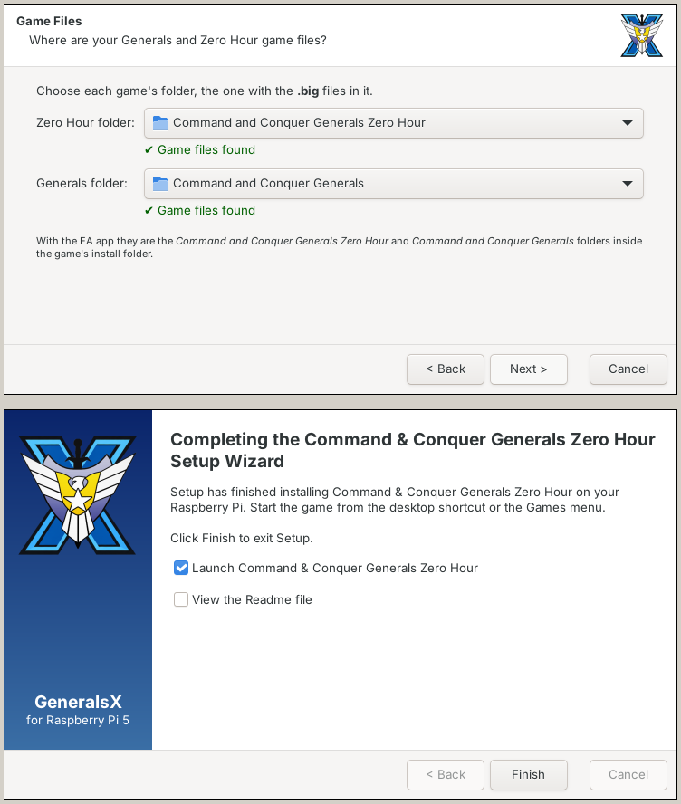

<p align="center">
  
</p>

<h1 align="center">GeneralsX for Raspberry Pi 5</h1>

<p align="center">
  <strong>Command & Conquer: Generals Zero Hour, running natively on a Raspberry Pi 5.</strong>
</p>

<p align="center">
  <a href="https://github.com/captainchapster/GeneralsX_RPI5/releases/latest"></a>
  <a href="https://github.com/captainchapster/GeneralsX_RPI5/actions/workflows/build-pi5.yml"></a>
  <a href="https://github.com/fbraz3/GeneralsX"></a>
</p>

---

> **This is an unofficial fork.** It is the Raspberry Pi 5 edition of [GeneralsX](https://github.com/fbraz3/GeneralsX), the Mac/Linux/Windows port of Generals and Zero Hour. It is not supported by the GeneralsX team, so please report Pi problems [here](https://github.com/captainchapster/GeneralsX_RPI5/issues), not upstream.

## The story

It started with a simple question: could a Raspberry Pi 5 run Zero Hour? Not through an emulator or by streaming it from a PC, but natively, on the Pi's own little GPU.

The Pi I wanted it on runs Twister OS, dressed up as Windows XP, on a 3440x1440 ultrawide behind a KVM switch. That was the right place for a game from 2003.

The answer turned out to be yes. The campaign, skirmish, save/load and the videos all work, and the game logs its own frame rate. In a 24-minute LAN match on Victory Valley at 1024x768, it measured an average of 35 FPS, with the slowest 1% of frames at 11 FPS. One evening the Pi played a LAN match against a Windows PC: two players, two bots, start to finish, without a single desync.

Getting there took a lot of fixes for a 64-bit ARM board that the game was never designed for, and then an installer that feels like it came off a CD in 2003. I ([@captainchapster](https://github.com/captainchapster)) built this port with [Claude Code](https://claude.com/claude-code) as my engineer. It debugged the graphics driver, chased the audio glitches and wrote the Setup wizard, while I tested every build on the real hardware.

## Install

You need:

- A **Raspberry Pi 5** (tested on 8 GB) with a 64-bit desktop OS: Raspberry Pi OS, Debian bookworm or Twister OS.
- Your own copy of **Generals** and **Zero Hour** (Steam, EA app or the original discs). Copy both game folders to a USB stick. The game files are not included.

Then:

1. Plug in the USB stick with your game files.
2. Download `GeneralsXZH-pi5-aarch64.tar.gz` from the **[latest release](https://github.com/captainchapster/GeneralsX_RPI5/releases/latest)**.
3. Right-click it, choose **Extract Here**, open the `GeneralsXZH-pi5` folder and double-click **Setup**.

<p align="center">
  
</p>

Setup finds your game files, installs what it needs, copies everything with a progress bar, and adds the game to the Games menu and, if you like, the desktop. The full guide, with LAN play and troubleshooting, is in **[docs/HOWTO/RASPBERRY_PI_5.md](docs/HOWTO/RASPBERRY_PI_5.md)**.

## What works

| | |
|---|---|
| ✅ Campaign and skirmish vs AI | ✅ Save and load |
| ✅ Music, sound effects and videos | ✅ LAN play, including against Windows PCs |
| ✅ Widescreen monitors (with black bars) | ❌ Online play (not set up yet) |

## What's different from GeneralsX

- **64-bit ARM build**: GeneralsX targets x86-64 Linux, macOS and Windows. This fork adds an aarch64 preset and builds DXVK from source.
- **Pi GPU support**: the Pi's V3D GPU lacks several Vulkan features DXVK expects. Small DXVK patches in [`cmake/patches/dxvk`](cmake/patches/dxvk) work around them, and the package brings its own newer Mesa driver, which only the game uses.
- **One-click install**: a classic Setup wizard, a ready-made package built by GitHub Actions on an arm64 runner, and a clean uninstaller.
- **Fixes found along the way**: audio, the intro order and the Microwave Tank's heat haze. They are written so they also work on the other platforms.

The fork follows GeneralsX: every week a workflow merges the latest upstream changes into a pull request and builds the Pi package from it, so improvements from GeneralsX keep arriving here.

## Building it yourself

On a Pi 5 (or any arm64 Debian bookworm machine):

```bash
./scripts/build/linux/build-pi5-zh.sh
./scripts/build/linux/deploy-linux-zh.sh linux-aarch64
./scripts/build/linux/run-pi5-zh.sh
```

See [Building it yourself](docs/HOWTO/RASPBERRY_PI_5.md#building-it-yourself) for the details.

## Credits

This port only exists because of the people who did the hard parts first:

* **[GeneralsX](https://github.com/fbraz3/GeneralsX)** by [@fbraz3](https://github.com/fbraz3) and contributors, the cross-platform engine this fork is built on. If you enjoy this, consider [sponsoring GeneralsX](https://github.com/sponsors/fbraz3).
* **[TheSuperHackers](https://github.com/TheSuperHackers/GeneralsGameCode)** for the code modernization and preservation work underneath it.
* **[Fighter19](https://github.com/Fighter19) & [feliwir](https://github.com/feliwir)** for pioneering SDL3, DXVK and OpenAL in Zero Hour.
* **[DXVK](https://github.com/doitsujin/dxvk)** and the **[Mesa](https://mesa3d.org/) V3DV** driver developers, for making Direct3D on a Pi possible at all.
* **[Westwood Studios & EA](https://www.ea.com/)** for creating Command & Conquer: Generals.

## License

See the [LICENSE](./LICENSE.md) file for details.
*EA has not endorsed and does not support this product. Command & Conquer is a trademark of Electronic Arts Inc.*
